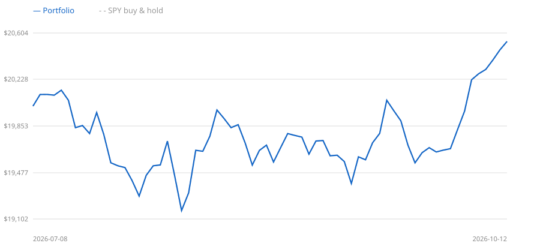

# Paper Trading Account — Performance Report

**➜ [Interactive dashboard](https://jasper-bolante.github.io/paper-trader/)** — hover/click any term to learn what it means, toggle the chart lines, and browse full trade history.

_Updated 2026-10-30 18:47 UTC · inception 2026-07-08 · drawdown state: **normal**_

## Account

| | |
|---|---:|
| **Equity (net of tax reserve)** | **$19,853.62** |
| Total return since inception | -0.73% |
| S&P 500 benchmark (same $ , dividends reinvested) | $20,596.42 (2.98%) |
| Positions value | $16,120.78 |
| Settled cash | $1,872.72 |
| Unsettled cash (T+1) | $1,875.77 |
| Tax reserve | $15.66 |

## Risk-adjusted metrics

| Metric | Portfolio | Benchmark |
|---|---:|---:|
| Total return | 0.97% | 2.80% |
| Annualized volatility | 11.48% | 11.01% |
| Sharpe (rf 4%) | -0.03 | 0.48 |
| Max drawdown | 4.83% | 3.57% |
| EOD observations | 81 | 81 |

## Positions

| Symbol | Qty | Avg basis | Last | Value | Unrealized | Stop |
|---|---:|---:|---:|---:|---:|---:|
| APA | 19 | $44.15 | $52.48 | $997.12 | $158.23 | $46.71 |
| CRL | 3 | $296.67 | $354.52 | $1,063.56 | $173.54 | $338.48 |
| EL | 10 | $105.95 | $108.84 | $1,088.40 | $28.92 | $98.41 |
| IQV | 2 | $255.46 | $264.66 | $529.32 | $18.41 | $251.42 |
| IT | 3 | $226.78 | $226.66 | $679.97 | $-0.38 | $203.99 |
| MPC | 2 | $442.06 | $442.58 | $885.16 | $1.04 | $397.53 |
| NTAP | 4 | $207.54 | $196.68 | $786.72 | $-43.46 | $177.01 |
| PLTR | 5 | $194.57 | $184.62 | $923.10 | $-49.76 | $181.53 |
| PSX | 4 | $270.63 | $281.50 | $1,126.00 | $43.47 | $246.29 |
| RVTY | 9 | $122.75 | $156.38 | $1,407.42 | $302.70 | $149.17 |
| SPY | 5 | $743.10 | $751.36 | $3,756.80 | $41.30 | — |
| TECH | 12 | $72.32 | $72.69 | $872.34 | $4.50 | $65.44 |
| WDAY | 6 | $194.97 | $197.34 | $1,184.04 | $14.24 | $175.89 |
| WST | 2 | $370.69 | $410.42 | $820.84 | $79.46 | $374.59 |

## Realized gains & tax

| Year | ST net (allowed) | LT net (allowed) | Wash-disallowed | 
|---|---:|---:|---:|
| 2026 | $-1,007.39 | $0.00 | $1,299.66 |

Dividends received: $104.43. Assumed rates: 24% short-term, 15% long-term, 15% dividends, no state tax.

## Recent decisions

- `2026-10-30T18:47` entry buy **NTAP** — momentum entry: rank 7, mom 0.614, vol 42%
- `2026-10-30T18:47` entry buy **IT** — momentum entry: rank 5, mom 0.623, vol 45%
- `2026-10-30T18:47` no_trade skip_entry **VEEV** — sector cap: Health Care would exceed 25% of equity
- `2026-10-30T18:47` exit sell **NTAP** — trailing stop 10%
- `2026-10-30T18:47` exit sell **ZBRA** — trailing stop 10%
- `2026-10-29T23:31` system — eod_complete
- `2026-10-29T23:31` system — corporate_actions_synced
- `2026-10-29T19:09` entry buy **WDAY** — momentum entry: rank 7, mom 0.595, vol 34%
- `2026-10-29T19:09` entry buy **PSX** — momentum entry: rank 6, mom 0.604, vol 37%
- `2026-10-29T19:09` no_trade skip_entry **VEEV** — sector cap: Health Care would exceed 25% of equity
- `2026-10-29T19:09` exit sell **FTNT** — trailing stop 10%
- `2026-10-28T23:27` system — eod_complete
- `2026-10-28T19:02` entry buy **MPC** — momentum entry: rank 1, mom 0.830, vol 42%
- `2026-10-28T19:02` no_trade skip_entry **CRM** — insufficient investable cash (size $413, need >= $500)
- `2026-10-28T19:02` no_trade skip_entry **CNC** — insufficient investable cash (size $413, need >= $500)

_Full decision log: `state/decisions.jsonl` · full history: `state/trader.db`_
