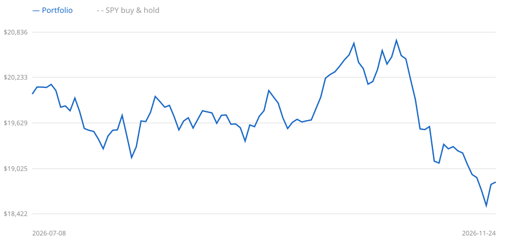

# Paper Trading Account — Performance Report

**➜ [Interactive dashboard](https://jasper-bolante.github.io/paper-trader/)** — hover/click any term to learn what it means, toggle the chart lines, and browse full trade history.

_Updated 2026-11-16 22:59 UTC · inception 2026-07-08 · drawdown state: **no_buys**_

## Account

| | |
|---|---:|
| **Equity (net of tax reserve)** | **$19,080.87** |
| Total return since inception | -4.60% |
| S&P 500 benchmark (same $ , dividends reinvested) | $19,959.94 (-0.20%) |
| Positions value | $9,031.78 |
| Settled cash | $10,058.75 |
| Unsettled cash (T+1) | $6.23 |
| Tax reserve | $15.89 |

## Risk-adjusted metrics

| Metric | Portfolio | Benchmark |
|---|---:|---:|
| Total return | -4.66% | -0.38% |
| Annualized volatility | 12.32% | 14.45% |
| Sharpe (rf 4%) | -1.32 | -0.28 |
| Max drawdown | 7.94% | 6.06% |
| EOD observations | 93 | 93 |

## Positions

| Symbol | Qty | Avg basis | Last | Value | Unrealized | Stop |
|---|---:|---:|---:|---:|---:|---:|
| EL | 10 | $105.95 | $108.56 | $1,085.60 | $26.12 | $102.06 |
| RVTY | 9 | $122.75 | $148.84 | $1,339.56 | $234.84 | $149.17 |
| SPY | 5 | $743.10 | $740.04 | $3,700.20 | $-15.30 | — |
| TECH | 12 | $72.32 | $72.81 | $873.72 | $5.88 | $65.55 |
| VEEV | 4 | $305.03 | $299.39 | $1,197.56 | $-22.56 | $279.52 |
| WST | 2 | $370.69 | $417.57 | $835.14 | $93.76 | $375.81 |

## Realized gains & tax

| Year | ST net (allowed) | LT net (allowed) | Wash-disallowed | 
|---|---:|---:|---:|
| 2026 | $-1,331.91 | $0.00 | $1,512.22 |

Dividends received: $105.91. Assumed rates: 24% short-term, 15% long-term, 15% dividends, no state tax.

## Recent decisions

- `2026-11-14T01:24` system — eod_complete
- `2026-11-13T20:37` no_trade — no signals crossed action thresholds this hour
- `2026-11-13T20:37` no_trade skip_entry — no entries: drawdown state 'no_buys'
- `2026-11-13T20:37` system **TECH** — cash settles on pay date; 15% dividend tax reserved
- `2026-11-12T21:01` system — eod_complete
- `2026-11-12T01:58` system — eod_complete
- `2026-11-11T00:51` system — eod_complete
- `2026-11-10T20:34` no_trade skip_entry — no entries: drawdown state 'no_buys'
- `2026-11-10T20:34` exit sell **WDAY** — momentum rank decayed (None > 150 or ineligible: below 50DMA (trend filter))
- `2026-11-10T20:34` exit sell **PSX** — momentum rank decayed (None > 150 or ineligible: below 50DMA (trend filter))
- `2026-11-10T20:34` exit sell **MPC** — momentum rank decayed (None > 150 or ineligible: below 50DMA (trend filter))
- `2026-11-10T20:33` system **WST** — cash settles on pay date; 15% dividend tax reserved
- `2026-11-09T23:07` system — eod_complete
- `2026-11-07T00:14` system — eod_complete
- `2026-11-06T20:03` no_trade skip_entry — no entries: drawdown state 'no_buys'

_Full decision log: `state/decisions.jsonl` · full history: `state/trader.db`_
