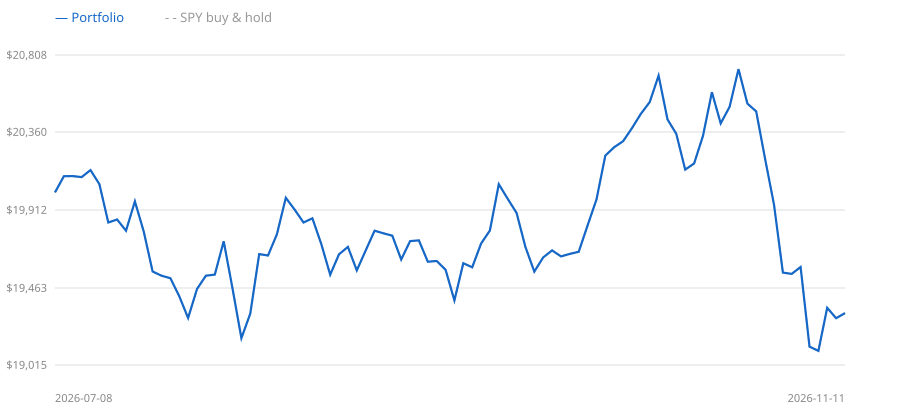

# Paper Trading Account — Performance Report

**➜ [Interactive dashboard](https://jasper-bolante.github.io/paper-trader/)** — hover/click any term to learn what it means, toggle the chart lines, and browse full trade history.

_Updated 2026-11-07 00:14 UTC · inception 2026-07-08 · drawdown state: **no_buys**_

## Account

| | |
|---|---:|
| **Equity (net of tax reserve)** | **$19,096.47** |
| Total return since inception | -4.52% |
| S&P 500 benchmark (same $ , dividends reinvested) | $19,852.86 (-0.74%) |
| Positions value | $11,952.37 |
| Settled cash | $6,410.16 |
| Unsettled cash (T+1) | $749.60 |
| Tax reserve | $15.66 |

## Risk-adjusted metrics

| Metric | Portfolio | Benchmark |
|---|---:|---:|
| Total return | -4.58% | -0.91% |
| Annualized volatility | 12.45% | 13.90% |
| Sharpe (rf 4%) | -1.36 | -0.41 |
| Max drawdown | 7.86% | 6.06% |
| EOD observations | 87 | 87 |

## Positions

| Symbol | Qty | Avg basis | Last | Value | Unrealized | Stop |
|---|---:|---:|---:|---:|---:|---:|
| EL | 10 | $105.95 | $110.11 | $1,101.10 | $41.62 | $100.89 |
| MPC | 2 | $428.77 | $372.91 | $745.82 | $-111.73 | $351.03 |
| PSX | 4 | $274.37 | $245.65 | $982.60 | $-114.86 | $233.77 |
| RVTY | 9 | $122.75 | $155.13 | $1,396.17 | $291.45 | $149.17 |
| SPY | 5 | $743.10 | $736.07 | $3,680.35 | $-35.15 | — |
| TECH | 12 | $72.32 | $72.80 | $873.60 | $5.76 | $65.52 |
| VEEV | 4 | $305.03 | $303.80 | $1,215.20 | $-4.92 | $279.52 |
| WDAY | 6 | $194.97 | $192.98 | $1,157.88 | $-11.92 | $181.66 |
| WST | 2 | $370.69 | $399.82 | $799.65 | $58.27 | $374.59 |

## Realized gains & tax

| Year | ST net (allowed) | LT net (allowed) | Wash-disallowed | 
|---|---:|---:|---:|
| 2026 | $-1,110.84 | $0.00 | $1,512.22 |

Dividends received: $104.43. Assumed rates: 24% short-term, 15% long-term, 15% dividends, no state tax.

## Recent decisions

- `2026-11-06T20:03` no_trade skip_entry — no entries: drawdown state 'no_buys'
- `2026-11-06T20:03` exit sell **IT** — trailing stop 10%
- `2026-11-06T01:29` system — eod_complete
- `2026-11-06T01:29` system — corporate_actions_synced
- `2026-11-05T20:47` no_trade — no signals crossed action thresholds this hour
- `2026-11-05T20:47` no_trade skip_entry — no entries: drawdown state 'no_buys'
- `2026-11-05T20:47` system — drawdown_state
- `2026-11-05T01:00` system — eod_complete
- `2026-11-04T20:31` entry buy **PSX** — momentum entry: rank 5, mom 0.462, vol 35%
- `2026-11-04T20:31` entry buy **MPC** — momentum entry: rank 3, mom 0.643, vol 40%
- `2026-11-04T20:31` no_trade skip_entry **HUM** — insufficient investable cash (size $870, need >= $500)
- `2026-11-04T20:31` exit sell **NTAP** — momentum rank decayed (None > 150 or ineligible: volatility 0.5383352861062571 above cap 0.5)
- `2026-11-04T20:31` exit sell **PSX** — trailing stop 10%
- `2026-11-04T20:31` exit sell **MPC** — trailing stop 10%
- `2026-11-04T00:48` system — eod_complete

_Full decision log: `state/decisions.jsonl` · full history: `state/trader.db`_
